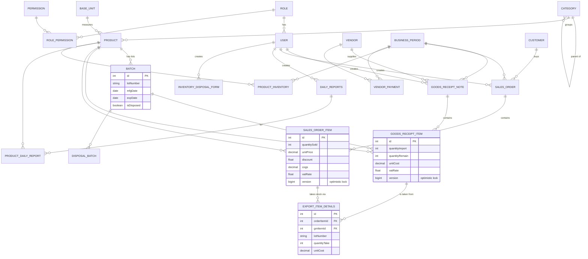

# Barista Raw Materials Inventory Management

A web application for coffee bars to track raw-material stock (beans, milk, syrups, cups...) **by purchase lot**, so that the cost of goods sold (COGS) of every sale reflects what was actually paid for the units consumed.

> **Screenshots:** _placeholder, to be added._
> `docs/screenshots/dashboard.png` · `docs/screenshots/goods-receipt.png` · `docs/screenshots/sales-order-lots.png`

## The problem it solves

Raw materials are bought repeatedly at different prices and expire at different dates. When stock is tracked as a single number per product, the cost of a sale has to be averaged or guessed, and expired lots go unnoticed. This project records every goods receipt line as its own lot (lot number, manufacturing and expiry date, unit cost, VAT rate, remaining quantity). Every sale line then draws quantities from specific lots, and its COGS is the sum of `quantity taken × lot unit cost`.

## Main features

- **Catalogue**: products with base units, pack sizes, categories (nested), images; vendors (tax code, licences); customers with ranks.
- **Goods receipts (import)**: create a goods receipt note with an invoice image, add items per lot (lot number, MFG/EXP dates, quantity, unit cost, VAT). An admin approves the note, which records the import in the current business period's inventory and VAT figures.
- **Batches**: browse lots with remaining quantity and expiry date; search, sort and filter.
- **Sales orders (export)**: for each sales line, staff choose the lots to take stock from; quantity sold and COGS are updated per lot. Concurrent edits of the same lot are rejected instead of overselling (see *Design decisions*).
- **Reporting**: dashboard (revenue, statistics), daily reports per product (import, export, COGS, revenue), inventory per business period, input/output VAT.
- **PDF export** of goods receipt notes and sales orders.
- **Accounts**: JWT login, user management with `admin` / `staff` roles enforced on the API.

## Tech stack

| Layer | Technologies |
| --- | --- |
| Backend | Java 21, Spring Boot 3.4 (Web, Data JPA / Hibernate, Security, Validation), JJWT 0.11, iText 5 (PDF), Lombok, Maven |
| Database | MySQL 8 (H2 in MySQL mode for tests) |
| Frontend | React 19, Vite 7, Ant Design 5, @ant-design/charts, React Router 7, Axios |
| Tests | JUnit 5, Mockito, AssertJ, Spring Boot Test, MockMvc |

## Architecture overview

```
frontend/bar-raw-materials   React SPA (pages -> components -> services/*Service.js axios clients)
backend/bar-raw-materials    Spring Boot REST API
  controllers/   REST endpoints, all under /api (auth/ and staff/ groups)
  services/      business logic and transactions (interface + *Impl)
  repositories/  Spring Data JPA repositories, JPQL/native queries and DTO projections
  dto/           request/response objects, so entities are not exposed directly
  entities/      JPA entities mapped to the MySQL schema
  exceptions/    domain exceptions + GlobalExceptionHandler (JSON error responses)
  config/, filter/  Spring Security, JWT filter, CORS, static image serving, startup config checks
```

**Authentication flow (JWT)**

1. `POST /api/auth/login` checks the username and BCrypt password, increments the user's `tokenVersion`, and returns an access token (HS256, 1 hour, with `role` and `tokenVersion` claims) plus a refresh token.
2. The SPA stores the token and sends `Authorization: Bearer <token>` on every request.
3. `JwtAuthenticationFilter` validates the signature, expiry and `tokenVersion` (a new login or a password change invalidates older tokens), then puts the user in the security context.
4. Everything except `/api/auth/**` and `/api/image/**` requires authentication. A 401 response makes the SPA log out.

**Authorization (roles)**

The user's role (`admin` or `staff`, loaded from the database on every request) becomes `ROLE_ADMIN` / `ROLE_STAFF`, checked with `@PreAuthorize`:

| Who | Endpoints |
| --- | --- |
| Admin only | account list/create (`/user/all`, `/user/list`, `/user/add`), goods receipt approval (`/grn/confirm/{id}`), VAT reports (`/productInventory/allProductVAT`, `/vatOverall`), business period `add` / `endPeriod` |
| Admin or the account owner | `/user/details/{id}`, `/user/update/{id}`, `/user/checkPassword/{id}`, `/user/resetPassword/{id}`; staff cannot change their own role or active status |
| Any authenticated user | everything else (catalogue, imports, sales, reports) |

A refused request returns `403` with `{"accessDenied": "..."}`. In the SPA, the `/accounts` and `/vat` pages are wrapped in `AdminRoute`, and a 403 shows an error message. Password hashes are never serialized in API responses.

## Data model

Generated from the JPA entities in `backend/bar-raw-materials/src/main/java/com/bar_raw_materials/entities` (key columns only for the core tables).



## Getting started

### Prerequisites

- JDK 21 (the Maven wrapper is included)
- Node.js 20+ and npm
- MySQL 8, either installed locally or via Docker (`docker-compose.yml`)

### 1. Configure the backend

```bash
cd backend/bar-raw-materials
cp .env.example .env
```

Edit `.env` and set at least `DB_USERNAME`, `DB_PASSWORD` and `JWT_SECRET_KEY` (generate one with `openssl rand -base64 32`). Spring Boot reads this file at startup (`spring.config.import=optional:file:.env[.properties]`); real environment variables take precedence. If a required value is missing, or the JWT key is shorter than 256 bits, the application stops with an explicit "APPLICATION FAILED TO START" report.

| Variable | Default | Purpose |
| --- | --- | --- |
| `DB_URL` | `jdbc:mysql://localhost:3306/bar_materials_db?useSSL=false&allowPublicKeyRetrieval=true` | JDBC URL |
| `DB_USERNAME` / `DB_PASSWORD` | _(required)_ | Database credentials |
| `JWT_SECRET_KEY` | _(required)_ | Base64 HMAC key, at least 32 bytes decoded |
| `SERVER_PORT` | `8080` | HTTP port of the API |
| `CORS_ALLOWED_ORIGINS` | `http://localhost:5173` | Comma-separated list of allowed frontend origins |
| `IMAGE_PATH` | `./images/` | Folder for uploaded images, served at `/api/image/**` |

### 2. Create the database

Either start MySQL with Docker (it reads the same `.env`; set `MYSQL_ROOT_PASSWORD` there, and `DB_USERNAME` must not be `root`):

```bash
docker compose --env-file backend/bar-raw-materials/.env up -d
```

or create it in an existing MySQL server:

```sql
CREATE DATABASE bar_materials_db CHARACTER SET utf8mb4 COLLATE utf8mb4_unicode_ci;
CREATE USER 'bar_app'@'%' IDENTIFIED BY 'change-me';
GRANT ALL PRIVILEGES ON bar_materials_db.* TO 'bar_app'@'%';
```

**Schema.** Tables are managed manually: Liquibase is disabled and Hibernate does not create tables by default, and the repository does not ship a schema dump yet (see *Known limitations*). For a fresh local database you can let Hibernate create the tables from the entities on the first run by adding `SPRING_JPA_HIBERNATE_DDL_AUTO=update` to `.env`, then removing it again. SQL migrations live in [`backend/bar-raw-materials/src/main/resources/db/migration`](backend/bar-raw-materials/src/main/resources/db/migration) and are applied manually, in version order. For an existing database created before optimistic locking was introduced, run [`V1__add_version_columns.sql`](backend/bar-raw-materials/src/main/resources/db/migration/V1__add_version_columns.sql) once.

**First admin account.** There is no sign-up endpoint. Insert the two roles and a first user with a BCrypt password hash, for example one generated with `htpasswd -bnBC 10 "" 'your-password' | tr -d ':\n'`:

```sql
INSERT INTO role (role) VALUES ('admin'), ('staff');
INSERT INTO user (username, password, firstName, lastName, email, phoneNumber, gender, isActive, roleId, tokenVersion)
VALUES ('admin', '<bcrypt-hash>', 'Admin', 'User', 'admin@example.com', '0000000000', 0, 1,
        (SELECT id FROM role WHERE role = 'admin'), 0);
```

### 3. Run the backend

```bash
cd backend/bar-raw-materials
./mvnw spring-boot:run          # Windows: mvnw.cmd spring-boot:run
./mvnw test                     # unit + integration tests (H2, no MySQL needed)
```

### 4. Run the frontend

```bash
cd frontend/bar-raw-materials
cp .env.example .env.local      # set VITE_API_BASE_URL if the API is not on http://localhost:8080
npm install
npm run dev                     # http://localhost:5173
```

## Design decisions

- **Lot-level COGS with manually chosen lots.** Each goods receipt line is a lot with its own unit cost. When a sale line is filled, staff pick the lots and quantities (`ExportItemDetail`), and the line's COGS is `Σ quantityTake × unitCost` of those lots. Editing or deleting a pick puts the quantity back on the lot and subtracts its cost again. Only lots with remaining stock that have not expired are offered. The system does not impose an order (FIFO/FEFO); the person filling the order decides which lot the units come from.
- **`BigDecimal` for money.** Unit costs, prices, COGS and VAT amounts use `BigDecimal` and `DECIMAL(20,2)` columns, so totals do not suffer from floating-point rounding.
- **Optimistic locking against overselling.** `GoodsReceiptItem` and `SalesOrderItem` carry a `@Version` column. If two requests take stock from the same lot at the same time, the second commit fails (`ObjectOptimisticLockingFailureException`), its whole transaction is rolled back, and the API answers `409 Conflict` with a message asking the user to reload. `ExportItemConcurrencyTest` runs 8 parallel requests against one lot and checks that stock never goes negative; without the version columns the same test takes 24 units from a lot of 10.

## Known limitations

- Authorization is role-based only; the `permission` / `role_permission` tables exist but are not used yet.
- Changing your own password does not require the current password on the server; the UI asks for it in a separate `checkPassword` call.
- The JWT is stored in `localStorage`, so it is readable by any script running on the page (XSS exposure). The refresh token is issued but there is no refresh endpoint, so users log in again after the access token expires.
- No automatic FIFO/FEFO lot suggestion; lots are always chosen manually.
- The database schema and seed data are not versioned in the repository (Liquibase is present but disabled).
- `isActive` on users is not checked at login.
- Uploaded images under `/api/image/**` are served without authentication.

## License

[Apache License 2.0](LICENSE)
